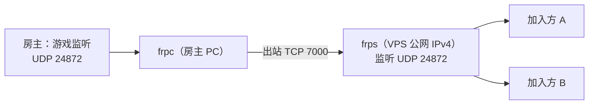

# MHGU 原生版联机：现状、IPv6 直连桥方案与问题

范围：`I:\suyu\export\MONSTER HUNTER GENERATIONS ULTIMATE`（用户实测在用的导出）与其源码 `G:/omp works/.tmp/ext/SUYU-GURecomp`（HEAD `35015f1`，版本 `0.10.0-test`）。
证据等级沿用 §2a：`[C]` = 本会话亲手跑过命令并记录输出的；`[B]` = 由证据推出但未单独验证的；`[U]` = 未验证。
独立复核：`V6BridgeReview`（dsv-remote）**已完成**，报告见同目录 `multiplayer-v6-bridge-review.md`；C1/C2/C4/C5/C6 确认，**C3 关于 RyuLdn 端口的那一半被推翻**（出货默认 `ryuldn_host = ldn.ryujinx.app` 时本机不开 30456 监听），C7 只确认"协议不协商 MTU"。本文已按复核改写，冲突时以复核为准。

---

## 0. 结论摘要

1. 这个 build 的联机**不是官方联机**：它把游戏自己的 Local Play（nn::ldn）搬到网络上，另外给游戏原本的在线大厅（NEX）留了一个"重定向到自建服务器"的口子。
2. 三条路：suyu room（ENet/UDP 24872）、RyuLdn（客户端连服务器的 TCP 30456，可与 Ryujinx 玩家同房；**出货默认 lobby 在 Ryujinx 公共服务器上，本机不监听**）、NEX 自建服务器（需独立公网 IPv4 机器）。
3. **IPv6 在这一栈的每一层都不支持**（游戏侧 HLE、suyu room、RyuLdn、NEX 全 IPv4），所以 IPv6-only 网络必须靠中继。
4. 用户提的"每台机器一个本地桥，用 IPv6 互连，把游戏的 IPv4 流量转成 v6 传"**可行**，正确落点是新增一个 `Network::LdnBackend` 实现（第四种传输），不是 TUN + NAT46。规模 `[B]` 800–1500 行。
5. 真正的难点不在传输：**没有房间目录**、**入站防火墙**、**v6 前缀会变**、**LDN 不协商 MTU 所以必须自己分片**、**覆盖不到 NEX**。
6. 动手前必须先跑一次 `ldn_census`（单人 10 分钟 + 1 局双人），它决定星型还是 mesh、是否要 TCP、分片阈值多少。

---

## 1. 这个 build 现在的联机能力

| 路径 | 传输 | 需要谁可达 | 配置 | 状态 |
|---|---|---|---|---|
| Local Play + suyu room | ENet / **UDP 24872** | 房主 | `[Multiplayer] mode = host\|join`、`address`、`port`、`password`、`nickname` | 现成可用 |
| Local Play + RyuLdn | 客户端到 LdnServer 是 **TCP 30456** | 看 `ryuldn_host`：默认 `ldn.ryujinx.app` 时 lobby 注册在 Ryujinx 公共服务器上，**本机不开监听**；只有把它设成空/`self`/本机地址（"Host for friends"）时，本机才自己开 30456 | `backend = room\|ryuldn\|auto`、`ryuldn_host/port/servers/passphrase` | 现成可用，标实验性 |
| 游戏在线大厅（NEX） | 游戏的 NEX/PIA，域名被重定向 | **一台不是玩家的公网 IPv4 机器** | `[Multiplayer] online_server_host` 或 F10 的 Online Server IP | 实验性，没有公共服务器 |

- 三条路的入口都在 **F10 游戏菜单 → Multiplayer**：Local 侧是 `Join Room` / `Ryujinx LDN` / `Public rooms` 三个标签，Online 侧只有 `Online Server IP` 一个输入框 `[C]`（`src/suyu_cmd/game_menu.cpp:735-790`）。
- 出货 ini 的实际值：`mode = off`、`nickname = Hunter`、`port = 24872`、`backend = room`、`online_server_host =`（空）`[C]`。
- `backend = room` 时 RyuLdn 层不激活（`ApplyModeLocked` 会把 crossplay bridge 置空），要跨平台必须在 F10 里切 **Both (automatic)** 或改 `backend = auto` `[C]`（`src/suyu_cmd/multiplayer.cpp:540-596`）。出货 exe 里三个模式字符串都在：`Both (automatic)` / `Suyu room` / `Ryujinx LDN` `[C]`。
- `ryuldn_public` 由代码在运行时读（`src/suyu_cmd/multiplayer.cpp:313`），但**不在 ini 键模板里**（`src/core/arm/recomp/game_settings_ini.cpp` 无此键），所以生成的 ini 里没有这一行；手工加仍会被读取 `[C]`。
- room 是**星型**：成员之间不直连，房主向其余成员重广播（`src/network/room.cpp:206-236` 的 `Broadcast…` 系列）`[C]`。
- room 的所有发送都带 `ENET_PACKET_FLAG_RELIABLE`（18/18 处 `enet_packet_create`），分片与重传由 ENet 负责 `[C]`。
- NEX 路径的实现要点：所有 Nintendo 在线域名被 `sfdnsres` 重定向到 `online_server_host`（`src/core/hle/service/sockets/sfdnsres.cpp:121-145`），环回时给 nncs1/nncs2 分配 127.0.0.2/127.0.0.3 以绕开"源 IP 等于 NAT 检查服务器就丢包"的规则 `[C]`。
- MHGU-NEX 的服务端要求写在它自己的 `SETUP.md`：公网 IPv4、TCP 443 + UDP 10025/10125/33334/33335、**服务器不能和玩家同机/同 IP**、不支持隐藏客户端 IP 的隧道 `[C]`（已读该文件）。

> **⚠ 文档与出货默认值不一致（照文档配会配错）** `[C]`：
> - `docs/a32recomp/RYULDN.md` 说本地联机"同时用 room 和 RyuLdn"、`backend` 默认 `auto`、`ryuldn_host` 默认空/`self`；**实际出货 ini 是 `backend = room`、`ryuldn_host = ldn.ryujinx.app`**（lobby 注册在 Ryujinx 公共服务器上，本机不开监听）。
> - `game_settings_ini.cpp` 里 `backend` 的注释只列了 `room` / `ryuldn`，**没提代码也接受的 `auto`**。
> - `ryuldn_public` 在 F10 帮助文本里有，但不在 ini 键模板里，生成的 ini 里永远看不到它。
> 结论：判断"这个 build 到底会怎么做"，以 **exe 字符串 + 实际 ini + 运行日志** 为准，不要以 `docs/` 的 HEAD 描述为准。

---

## 2. IPv6 现状：四层全不支持

| 层 | 结论 | 证据 |
|---|---|---|
| 游戏侧 HLE BSD | 没有 IPv6 socket | `Domain` 枚举只有 `Unspecified = 0, INET = 2`（`src/core/hle/service/sockets/sockets.h:54-57`）；`Translate(Domain)` 的 default 走 `UNIMPLEMENTED_MSG("Unimplemented domain={}")`（`sockets_translate.cpp:137-158`）`[C]` |
| 域名解析 | 只返回 IPv4 | `sfdnsres.cpp:217` 的 `h_addrtype` 写死 `Domain::INET` `[C]` |
| suyu room | IPv4 only | 基于 ENet（`src/network/room.cpp:17`），`ENetAddress` 只有 IPv4 `[C]` |
| RyuLdn | IPv4 only | 客户端 `hints.ai_family = AF_INET; // the master servers are IPv4`（`src/network/ryuldn/socket_util.cpp:76`）；服务端 `AF_INET` + `inet_pton(AF_INET,…)`，填 v6 直接报 `not an IPv4 address`（同文件 195-200）；`docs/a32recomp/RYULDN.md` 把 "IPv6 servers" 列在 Not done `[C]` |
| NEX | 要求公网 IPv4 | MHGU-NEX `SETUP.md` `[C]` |

推论 `[B]`：纯 IPv6-only 网络在这套 build 里拿不到任何直连路径，只能在某处做 IPv4↔IPv6 转换（VPS 中转 / Radmin / ZeroTier / IPv4 出口），或者自己实现第 3 节的桥。

---

## 3. 方案：V6Direct —— 新增一个 LdnBackend

### 3.1 为什么落在这里（三层对比）

| 落点 | 可行性 | 代价 |
|---|---|---|
| Windows TUN/WFP + 用户态 NAT46 | 能，但要驱动、管理员权限、假 IP 段与路由，且**游戏的 Local Play 流量根本不经过 Windows socket**，做了接不上 | 最高 |
| `internal_network`（HLE BSD 层） | 只对 NEX 在线路径有意义，而且还需要 NEX 会合服务器 | 中 |
| **`Network::LdnBackend`** | 接口已成型的 8 个纯虚 + 1 个可选（`GetFakeSubnetMask`），已有 Room / RyuLdn / Hybrid 三个实现可照抄 | 最低，推荐 |

接口（`src/network/ldn_backend.h:24-63`）`[C]`（8 个纯虚 + 1 个可选）：

- `IsConnected()`
- `GetFakeIpAddress()`（游戏看到的假 IPv4，由后端自己定）
- `GetFakeSubnetMask()`（可选，返回 `std::nullopt` 表示沿用宿主的掩码）
- `SendProxyPacket(const ProxyPacket&)` / `BindOnProxyPacketReceived(...)`
- `SendLdnPacket(const LDNPacket&)` / `BindOnLdnPacketReceived(...)`（房间发现/公告包；注释说明 Room 后端专用，其他后端可忽略）
- `Unbind(CallbackHandle)`（两种回调各一个重载）

数据结构（`src/network/room_member.h:32-47`）`[C]`：

```cpp
struct LDNPacket  { LDNPacketType type; IPv4Address local_ip, remote_ip; bool broadcast; std::vector<u8> data; };
struct ProxyPacket{ SockAddrIn local_endpoint, remote_endpoint; Protocol protocol; bool broadcast; std::vector<u8> data; };
```

也就是说"游戏的 IPv4 连接"在这一层**本来就是假的**：地址是 `GetFakeIpAddress()` 造出来的，所以"v4→v6 转换"只是换个 sendto 目标，不需要 NAT。

### 3.2 数据面

- 每进程一个 `AF_INET6` + `IPV6_V6ONLY=1` 的 UDP socket，固定端口（24872 可与 room 对齐），邀请串 `[2001:…]:24872`。
- 报文头 24 B：`magic(2) ver(1) type(1) flags(1) proto(1) len(2) session_id(8) from_v4(4) to_v4(4)`；`to_v4 = 0` 表示广播给所有 peer。
- 可选 PSK：ChaCha20-Poly1305，再 +28 B；`session_id` 至少过滤掉陌生人的包。
- **不做 TCP 封装，但可靠性层要等 V1 再决定**：用 TCP 承载会把队头阻塞带来的抖动灌进游戏，这一点是定论；但"游戏是否需要可靠有序交付"仍未知——room 对 LAN 作用域内 guest 的 TCP 和 UDP 一视同仁地塞进 `ENET_PACKET_FLAG_RELIABLE`（`room.cpp:885,891-893` 忽略 Protocol 字节、原样重发），所以"一条 UDP 隧道能跑通 room"与"guest 需要可靠交付"完全一致。注意作用域：目标不在 LDN 网段的 socket 会被换成真实 host socket、**不进 room**（`sockets/bsd.cpp:743-746,817,1145`），所以 room 只承载 LAN 内流量。census 给出 `proxied TCP sockets: none` 之前，不能把可靠性层删掉。
- **默认不 zstd，但理由不是"压不动"**：room 后端只对**数据面**（`ProxyPacket`）做 zstd —— 发送侧 `src/network/ldn_backend.cpp:75-81` 压缩、接收侧 `:96-99` 解压；**LDN 发现/控制包（`LDNPacket`）不压缩**（同文件 `:84-90` 直接转给 room）。所以"room 只压文本"是错的、但"LDN 全部压缩"也不对。v6direct 选择不压的理由是**逐包压缩的 CPU 成本 vs 实际包长**：包小到几百字节时 zstd 收益接近零（阈值等 census 的 `size min..max`），要压也应做成可开关、按流批量压。
- 扇出方式：**默认星型**（房主扇出，其余人只连房主）。依据是字段实践：房主只映射**一个** UDP 端口，yuzu + 原版 MHGU 的本地联机即可整局运行，说明"房主中继"这一种拓扑够用 `[U]`（用户转述，未复现）。**注意这条证据的边界**：room 把 LAN 作用域内 guest 的 TCP 和 UDP 一视同仁地塞进 `ENET_PACKET_FLAG_RELIABLE`（`room.cpp:891-893` 忽略 Protocol 字节、原样重发），数据面载荷还先 zstd 压缩（`ldn_backend.cpp:75-81`），所以它能证明的只有两件事：①星型拓扑可行；②该服务的单包上限 ≥ **约 1420 B**（ENet 1392 是 UDP 载荷预算，IP 层还要加 ENet 头）。它**不能**证明游戏只用 UDP，也**不能**证明裸的不可靠 UDP 传输够用——那两项仍然只有 census 能回答。全 mesh 只在 census 明确显示需要时才加（见第 5 节）。
- 接收线程 `recvfrom` → 改写成假 IPv4 → 投递回调；预分配环形缓冲，避免每包 vector 分配。
- 假地址分配：握手时取最低空闲序号（如 `10.114.0.1+i`），两端各自维护 `virtualIPv4 ↔ sockaddr_in6` 映射。

### 3.3 控制面（会合）

- **双端同时向对方发包**，不要做单向探测：v6 没有 NAT，但家用路由和 Windows 防火墙都是"默认拒绝入站"，只有各自先出站一次才会为回包开窗。之后用应用层 `PING/PONG` 确认。
- 只接受全球地址 `2000::/3`；拒绝 `fe80::`（带 scope id，不能跨网）和 `fc00::/7`（ULA 不可路由）。
- 握手交换 `session_id / 虚拟 IPv4 / 昵称 / 版本 / PSK 摘要`，版本不一致直接拒绝。
- 地址簿持久化到 ini（`v6_peers`），支持"上次加入过的房主"一键重连。

### 3.4 接入与工作量

- 照 `HybridLdnBackend` 的写法加成第四种传输，F10 模式里多一项 `IPv6 direct`；配置 `[Multiplayer] v6_port / v6_peers / v6_psk`。
- 规模 `[B]`：新增 `src/network/v6direct/` 约 800–1500 行，加配置/菜单接线与一个双进程测试。
- 复用现有地址重写逻辑，不要重写第二套（RyuLdn 的 `room_bridge.cpp` 已经在处理替身地址，就是同一个坑）。

---

## 4. MTU 与分片：LDN 协议不协商，但游戏以为有 1500

- LDN 协议层**不传任何上限**：`CommonNetworkInfo` 只有 `bssid / ssid / channel / link_level / network_type` + 4 B 填充，共 `0x30` 字节（`src/core/hle/service/ldn/ldn_types.h:224-232`）；`src/core/hle/service/ldn/` 与 `src/network/` 全树 grep `mtu` **零命中** `[C]`。
- **但"没有 MTU"只说对了一半**：guest 看到的接口 MTU 来自 `nifm`，是写死的 **1500**（`src/core/hle/service/nifm/nifm.cpp:160` 的 `u16 mtu{}`、`:703` 的 `.mtu{1500}`）`[C]`。所以游戏在合法范围内可以发到约 **1472 B**（1500 − 28 B IPv4 头，它按 IPv4 记账）。
- 现有后端把这个藏住了：room 全部 `ENET_PACKET_FLAG_RELIABLE`（ENet 自带分片+重组，ENet 1.3.x 默认 MTU 1392）`[B]`；RyuLdn 走 TCP（无 MTU 概念）`[C]`。**新的 raw-UDP 后端是第一个真正暴露 MTU 的传输。**
- 容量公式（不是固定常数，取决于我们自己的头长度）：

  ```
  payload_max = 路径MTU − 48(IPv6 40 + UDP 8) − 自定头
  20 B 头：1500 → 1432，1280 → 1212
  24 B 头：1500 → 1428，1280 → 1208
  ```

  参考：树里已有的 `ProxyDataHeader`（RyuLdn 的代理头，`src/network/ryuldn/protocol.h:146-157`）就是这个量级，但**我们的头长度是自己的设计选择**，不要拿 72 B 当常数引用 `[C]`。
- 结论：既然游戏合法可发 1472 B，而 1500 路径减去 48 + 头最多只剩 1432 B 左右，**"超过路径容量就静默丢"是必然会踩到的**，所以分片不是可选项——`ldn_census` 只决定"窗口开多大、是否要压缩/是否大多数包其实很小"。

| census 实测 payload max | 需要什么 |
|---|---|
| ≤ 路径 − 48 − 头（典型 1432） | 不需要分片，也不需要探测 |
| 超过上式 | **必须**应用层分片/重组；同时保留握手探测处理 1280 路径 |

- 分片做在应用层：头里加 `frag_id(2) idx(1) count(1)`，2 秒收不齐整包丢弃，交给 LDN 自己重发。**不要依赖 IPv6 Fragment 头**——发送端分片合法，但很多防火墙见分片就丢 `[B]`。

---

## 5. 动手前必须先测：`ldn_census`

- 开关：`[Diagnostics] diagnostics = true`（旧段名 `[Debug]` 也认，`src/core/arm/recomp/game_settings_ini.cpp:127-129`，默认 false）`[C]`。
- 输出：`src/core/internal_network/ldn_census.cpp:98` 写到 `GetSuyuPath(SuyuDir)/ldn_census.txt`；`SuyuDir` 是 `EdenDir` 的别名（`src/common/fs/path_util.h:36-37`），导出里等于 `user_root`（`src/suyu_cmd/suyu.cpp:458`）→ 即 `user\ldn_census.txt` `[C]`。
- 频率：后台线程每 10 秒重写一次（`StartWriterLocked`），计数是从启动累计的，最后一份就够 `[C]`。
- 内容（`WriteLocked`）：`# summary`（是否用到代理 TCP、广播包数）、`# unicast A -> …`（谁跟谁说话）、`## LDN states`、`## sockets`（fd / domain/type/protocol / proxy 或 real / 各调用计数）、`## packets out` 与 `## packets in`（每条流：源:端口 → 目的:端口、bcast、包数、字节数、`size min..max`、首末时间）`[C]`。
- 判读规则：

| 现象 | 决定 |
|---|---|
| `# unicast` 每个源只有一个目的且都是房主 | 星型够用，不做 mesh |
| `# unicast` 出现 guest → guest | 必须 mesh（或让房主中转） |
| `proxied TCP sockets: YES` | "只用 UDP"不成立，传输层必须带可靠有序通道，或者继续用 room 承载 |
| `size min..max` | 决定第 4 节的分片档位 |

- 流程：① 改 ini 重启 → ② 单人进集会所开 Local Play，10 秒后确认 `user\ldn_census.txt` 出现（这一步已能回答 TCP/UDP 与 socket 类型）→ ③ 用现有的 Radmin/FRP 房间打一局双人，两边各留一份 → ④ 立刻拷走，关掉 `diagnostics`（它会同时开 profiler / FSM 监视，掉帧）。
- 限制：census 只统计**被代理的 LDN 包**（挂在 `socket_proxy.cpp` 与 `lan_discovery.cpp`），NEX 在线大厅的流量不在里面 `[C]`。

---

## 6. 问题清单（按严重度）

| # | 问题 | 后果 | 缓解 |
|---|---|---|---|
| 1 | **没有房间目录** | room 有 `LANDiscovery` 的广播公告，RyuLdn 有服务器存 lobby；纯 P2P 之后游戏内"搜索本地房间"只能看到已邀请的人 | gossip 转发 `LDNPacket` 公告；要公共房必须另加目录服务 |
| 2 | **入站防火墙** | v6 无 NAT ≠ 可入站；家用路由与 Windows 防火墙默认 drop unsolicited，单向探测全灭 | 双端同时发包 + 放通 exe 的 UDP 端口；严格策略只能回落中继 |
| 3 | **v6 前缀会变** | 家宽 PD 前缀每天变，邀请串过期 | DDNS / 每次开房重发；比 FRP、Radmin 是净退步 |
| 4 | **v6 覆盖率** | 有人只有 IPv4/CGNAT，或路由器关了 v6 | 必须保留 room / RyuLdn / FRP 回落，它是第四种后端不是替代品 |
| 5 | **NEX 在线大厅仍不通** | 只解决 Local Play 的传输，matchmaking + NAT 检查依旧要服务器 | 那条路继续用 MHGU-NEX |
| 6 | **任意注入** | P2P 直接暴露端口，谁都能往 guest 塞 LDN 包 | `session_id` + PSK-AEAD + 长度/类型校验，缺一不可 |
| 7 | **会话语义缺失** | room 有 join request / 密码 / 满员 / kick / `auto_reconnect`，P2P 全要重写 | 先只做"邀请即入 + 掉线重连"，kick 不做 |
| 8 | **MTU 无协商** | 超容量包静默丢（见第 4 节） | 默认 1428、探测、必要时应用层分片 |
| 9 | **地址重写 bug** | 双向映射 + 广播语义是这类实现最常见的坑 | 复用 RyuLdn `room_bridge` 的重写逻辑，别写第二套 |

不在方案里的东西（明确不做）：TUN/NAT46 驱动、TCP 封装、zstd 压缩、用 IPv6 打通 NEX。

---

## 7. 验证步骤

1. **离线**：单进程双 socket（`::1`）互发 1000 包，验证头解析、`virtualIPv4 ↔ sockaddr_in6` 映射、广播扇出、frag 重组超时。
2. **单机**：同机双开两个导出实例，`v6_peers = [::1]:24872`，进集会所开一局、退房、重进。
3. **跨网**：两台不同网络（其中一台用手机 v6 热点）验证全球地址、双端同时发包能否一次打通；记录失败时的防火墙表现。
4. **回归**：`backend = auto` 下 room / RyuLdn / v6direct 三者切换不互相污染（切换要求先离开大厅，`SetLdnMode` 会拒绝在房间内切换）。

---

## 8. 附：用 FRP 联机（操作步骤）

拓扑：**只有房主**需要 `frpc`，加入方零安装，只拿一个 `VPS公网IP:24872`。



依据：suyu room 是星型，房主向其余成员重广播（`src/network/room.cpp:206-236`），所以只有房主一个点需要可达；`port` 默认 24872（`game_settings_ini.cpp:161`）。

**VPS（`frps.toml`，frp v0.52+ 用 TOML；更老的版本用 `[common]` ini）**

```toml
bindAddr = "0.0.0.0"
bindPort = 7000
auth.method = "token"
auth.token = "换成随机串"
udpPacketSize = 1500
```

- 云安全组 + 主机防火墙放通 **UDP 24872**（游戏房间）和 **TCP 7000**（frpc 接入，建议限制来源 IP 为房主出口）。
- frps 必须跑在有**公网 IPv4** 的机器上；加入方是用 IPv4 连它的。

**房主 PC（`frpc.toml`）**

```toml
serverAddr = "VPS公网IP"
serverPort = 7000
auth.method = "token"
auth.token = "同一串"
udpPacketSize = 1500

[[proxies]]
name = "mhgu-room"
type = "udp"
localIP = "127.0.0.1"
localPort = 24872
remotePort = 24872
```

日志出现 `start proxy success` 即通。房主本机不需要为 24872 开入站规则（frpc 走 loopback 连游戏）。

**游戏内**：F10 → Multiplayer → Name（4–20 字符，每人不同）→ 房主 **Host** → 把 `VPS公网IP:24872` 发给朋友（**不是** Radmin 地址）→ 朋友 **Join Room** 粘贴 → 集会所 Local Play。

**排错**

| 现象 | 原因 |
|---|---|
| frps 日志有 proxy 启动，外面连不上 | 云安全组没放 UDP 24872（最常见）；`udpPacketSize` 两端不一致 |
| `bind error: port already in use` | 同一台 VPS 上另一组已经占了 24872，换 `remotePort`（24873…），邀请串同步改 |
| 连通但一进任务就断 | 路径 MTU 变小或中间设备丢 UDP；FRP 无法解决，换 Radmin/room |
| 延迟高/卡顿 | 所有流量绕 VPS，选离双方都近的节点 |

**不要用 FRP 做 NEX 在线大厅**：MHGU-NEX 要求服务器不与玩家同 IP，且不支持隐藏客户端 IP 的隧道（见 L10）。

**可选：让 Ryujinx 玩家也进（RyuLdn）**——只有把 `ryuldn_host` 设成 `self`/空/本机地址时，房主机器才会自己开 TCP 30456 监听；这时再加一条 `type = "tcp"`、`localPort = 30456`、`remotePort = 30456` 的映射，Ryujinx 朋友把 LDN 服务器填成 `VPS公网IP:30456`。我们自己的客户端在该模式下连 `127.0.0.1:30456`（`multiplayer.cpp:286-327`），不经 FRP。属实验性。

### 8.1 用别人 VPS 上的第三方端口映射服务

判据不是"走不走 HTTPS"，而是**它能不能给一条 UDP 隧道**。TLS 只是加密通道，隧道里转发的协议才决定能不能用。

| 服务形态 | 能不能用 | 理由 |
|---|---|---|
| HTTP/HTTPS 反向代理（只给你一个 `https://域名`） | **不行** | 它按 HTTP 请求解析；游戏是 UDP，包根本进不去 |
| 支持 UDP 隧道的内网穿透（SakuraFrp/natfrp 等） | 可以 | 建 `udp` 隧道、本地端口 24872，拿到 `节点域名:端口` |
| playit.gg 一类游戏隧道（支持 UDP） | 可以试 | 为游戏服务器设计，免费/低价档；对具体游戏的传输支持有已知问题，要实测 |
| Cloudflare Tunnel 的公网主机名 | **不行** | 只承载 HTTP/HTTPS；任意 TCP/UDP 要走 Spectrum（付费、需专用 IP） |
| ngrok | **不行** | 没有 UDP 隧道类型 |

验收清单（挑服务时逐条对）：

1. 有 **UDP** 类型，且**双向**——ENet 要回包，单向转发等于不通。
2. 给的是 `host:port`。随机端口可以，但每次重开会变，邀请串要重发。`ParseInvite` 按最后一个 `:` 切端口，域名没问题。
3. 单包上限 ≥ **约 1420 B**（房间包按 ENet MTU 1392 分片）。服务商限制更小会出现"能进房、一开任务就断"。
4. 允许持续小包（几十包/秒），不是按 HTTP 请求计数。
5. **不要开访问认证/密码**：UDP 隧道通常不支持密码/TOTP（SakuraFrp 文档明说），开了直接连不上。

字段旁证 `[U]`（用户转述，未复现、无日志）：已知有这类服务能跑 **yuzu + 原版 MHGU** 的本地联机整局。它合法的结论只有两条：

1. **星型/房主中继**在实际网络里够用（单端口映射、全员连房主即可整局）。
2. 该服务的**单包上限 ≥ ENet MTU 量级（约 1392 B）**——因为 room 把每个包按 ENet 分片发出，能跑通就说明这个下限被满足。

它**不能**证明的三条：游戏是否只用 UDP、裸的不可靠 UDP 传输是否够用（room 对所有包都用 `ENET_PACKET_FLAG_RELIABLE`，TCP 与 UDP 一视同仁，`room.cpp:891-893`）、以及 MHGU 原始载荷的尺寸分布（room 先 zstd 压缩再发，`ldn_backend.cpp:75-79`）。这三项仍然是 V1–V3 的 census 任务。

风险：流量、延迟、地址都过第三方机器；免费额度/限速/条款可能禁止游戏用途；房主与玩家的 IP 对服务方可见；节点抖动会直接进游戏。另外它同样**不能**用于 NEX 在线大厅（见 L10）。

---

## 9. 与 yuzu 同房（跨实现）

已按源码逐字段核验（复核见 `yuzu-room-compat-review.md`）：

| 项 | 结论 | 证据 |
|---|---|---|
| yuzu 的"多人游戏 → 创建房间"是什么 | yuzu 自己的 Room：ENet over **UDP**，默认端口 24872（`Network::DefaultRoomPort`） | `host_room.ui` 字段（房间名称/用户名/首选游戏/密码/最大玩家数/端口 8）、`room.h` |
| 协议版本 | 双方都是 `network_version = 1`，join 被硬门禁：`client_version != network_version` 直接拒绝 | suyu `room.h:24`、`room.cpp:357`；yuzu 上游 `room.h` 同值 |
| 消息类型 | `RoomMessageTypes` 枚举逐项相同 | suyu 与 yuzu 上游 `room.h` 逐行对比 |
| 加入包布局 | 相同：`IdJoinRequest, nickname, preferred_fake_ip, network_version, password, token` | 双方 `room_member.cpp` / `room.cpp` |
| 数据面布局 | 相同：`IdProxyPacket, local(family/ip/port), remote(family/ip/port), protocol, broadcast, data` | 双方 `RoomMember::SendProxyPacket` |
| 压缩 | 双方都对**数据面**载荷先 zstd（yuzu 在 `internal_network/socket_proxy.cpp:192-194`，本 build 在 `ldn_backend.cpp:75-81`） | 两侧源码 |

结论：**suyu 与 yuzu 镜像 master 的 room 在协议层逐字段相同** `[C]`（`network_version = 1`、`RoomMessageTypes` 枚举、join 包字段序、`IdProxyPacket` 布局、两侧都做 zstd、假地址段都是 `192.168.x.y`）。"**yuzu 1734 精确版本**"仍是 `[B]`——镜像取不到 1734 这个 tag，只能证明它属于同一条代码线。所以跨实现同房"[B] 很可能成立"，实测层 `[U]`。已知分叉：本 build 的 room 对"目标地址不认识的单播"会转给房主成员再走网关（`room.cpp:916-918`，LDN 中继见 `:973`），yuzu 上游是丢弃——实际影响只能实测。

**版本才是真正的坑**：房间**传输层**不校验（`GameInfo.version` 只被记录，`room.cpp:1064`；RyuLdn 服务端也只广播不过滤，`ryuldn/server.cpp:530-562`），但 **LDN 层**把 `local_communication_version` 透传给游戏（`ldn_types.h:288` 的 `NetworkConfig`、`:241` 的 `NodeInfo`；`lan_discovery.cpp:622` 写入），**是否拒收由 MHGU 自己决定，源码里看不到** `[B]`。再加上重编译版把时序补丁写死在 1.4.0 偏移上（`INSTALL.md:97`），可行组合只有两种：**全员 1.4.0**（yuzu 侧装 1.4.0 更新），或**全员用导出**。1.3.0 的 yuzu 与 1.4.0 的导出不要指望能一起玩。

**帧率/模组** `[U]`：`[Display] fps` 是真实影响游戏时钟的输入（引擎浮点 `+0x243C`，`game_settings.h:22-30`）；yuzu 侧截图里还挂着 `60fps_stable`、`b4k`、`ChuckPatch` 等。联机双方应保持相同帧率与同类模组，否则不同步风险无法离线排除。

---

## 10. 证据索引

- `src/network/ldn_backend.h:24-63` — 后端接口与"压缩由后端自行决定"的注释
- `src/network/room_member.h:32-47` — `LDNPacket` / `ProxyPacket` 定义
- `src/network/room.cpp:17,206-236,637-640` — ENet、房主重广播、RELIABLE
- `src/network/room.h:26` / `game_settings_ini.cpp:161` — 默认房间端口 24872
- `src/network/ryuldn/socket_util.cpp:76,195-200` — RyuLdn 客户端/服务端均 IPv4
- `src/suyu_cmd/multiplayer.cpp:313,540-596` — `ryuldn_public` 读取、`backend` 模式与 RyuLdn 激活条件
- `src/suyu_cmd/game_menu.cpp:735-790` — Local 三个标签 + Online Server IP
- `src/core/hle/service/sockets/sockets.h:54-57`、`sockets_translate.cpp:137-158` — 无 INET6
- `src/core/hle/service/sockets/sfdnsres.cpp:121-145,217` — NEX 重定向与 `h_addrtype` 写死 INET
- `src/core/hle/service/ldn/ldn_types.h:224-232` — `CommonNetworkInfo` 无 mtu
- `src/core/internal_network/ldn_census.cpp:98,179-182` — 输出路径与开关
- `src/core/arm/recomp/game_settings_ini.cpp:127-129` — `[Diagnostics] diagnostics` 默认 false
- `docs/a32recomp/RYULDN.md`、`docs/a32recomp/INSTALL.md` §8、`docs/a32recomp/CHANGELOG.md`（0.10.0-test）
- 外部：`github.com/GURecomp/MHGU-NEX` 的 `README.md` / `SETUP.md`
- 外部：frp 配置参考 `github.com/fatedier/frp` 的 `conf/frpc_full_example.toml` / `conf/frps_full_example.toml`（v0.67.0：`auth.method`/`auth.token`、`udpPacketSize` 默认 1500、`[[proxies]] type="udp"`）
- 外部：yuzu 上游 `src/network/room.h`（`network_version = 1`、`RoomMessageTypes`）、`room.cpp`（join 读取顺序、版本门禁）、`room_member.cpp`（`SendProxyPacket` 字段序）、`src/core/internal_network/socket_proxy.cpp:192-194`（数据面 zstd）——经 GitLab 镜像 `git.lysator.liu.se/love/yuzu` 读取
